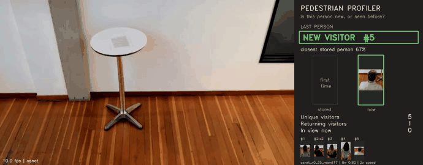

# Pedestrian Profiler

Watches a camera and tells you, for every person who walks by, whether it has seen
them before – and plays a sound when someone shows up who hasn't been seen yet today.



**What you see on screen**

```
NEW visitor #3                          SEEN BEFORE – visitor #3
closest existing 70%  (09:14:02)        match 97%, visit 2  (09:31:45)
not seen today – audio cue              already seen today
```

Next to each decision the app shows the stored photo and the current one, so you
can check the match yourself.

---

## Quick start (Windows)

```bat
setup_venv.bat                                  :: once – creates .venv and installs everything
.venv\Scripts\activate
python main.py --source videos\test_reid.mp4    :: try it on the included test video
python main.py                                  :: live webcam
```

Or in VS Code: open the folder → **Run and Debug** (Ctrl+Shift+D) → pick
**▶ Profiler – test video** → **F5**.

The first run downloads the model files (~25 MB) into `models/`.

---

## Using it

### 1. Mark the floor area (optional)

1. Click **Draw zone** – a box appears on the video.
2. Drag the **4 corners** onto the floor area you care about (e.g. the entrance mat).
   Any 4-sided shape works; drag inside the box to move it.
3. Click **Done**.

```
      ┌──────────── camera view ────────────┐
      │                                     │
      │        ●─────────────●              │   ● = draggable corner
      │       /    counted    \             │
      │      /   (feet inside) \            │
      │     ●───────────────────●           │
      │                                     │
      └─────────────────────────────────────┘
```

Only people whose **feet** are inside the zone are counted. The zone is saved
automatically, separately for the webcam and each video. **Clear zone** removes it
(then the whole picture counts).

### 2. Watch the panel on the right

* **Last person** – NEW or SEEN BEFORE, match %, and whether they were seen today.
* **Visitors** – unique visitors, visits today, new vs. returning, last hour.
* **Recent visitors** – list with photos.

### 3. Buttons

| button | does |
|---|---|
| Draw zone / Edit zone / Clear zone | set up the floor area |
| Use webcam / Use test video / Stop | switch the video source |
| Clear panel | empties the panel display (visitors are still remembered) |
| Reset visitors | forgets everyone |

---

## The "not seen today" audio cue

When a person in the zone is **new**, or was last seen **before midnight today**,
the app calls `play_cue()` in `src/audio_cue.py`. Someone already seen today gets
no cue.

Out of the box it beeps. Settings in `config.py`:

```python
AUDIO_CUE_ENABLED = True
AUDIO_CUE_SOUND = "beep"            # or r"C:\sounds\welcome.wav", or None for silence
AUDIO_CUE_URL = None                # or "http://localhost:8000/audio-cue"
```

With a URL set, every cue is also sent as a JSON POST:

```json
{"event": "not_seen_today", "visitor_id": 3, "first_ever": true, "ts": 1790752442.1}
```

To drive a real speaker system, replace the body of `play_cue()` – it runs in the
background, so it may take its time.

---

## How it recognises people

```
camera → find people (YOLOv8) → follow each one (tracker) → take ~5 good photos
       → turn them into an "appearance fingerprint" (OSNet + clothing colours)
       → compare with everyone stored → SEEN BEFORE or NEW
```

* Fingerprints are compared with a similarity score from 0 to 1.
  Above **0.88** → same person. Just below → the app waits for a few more photos.
* Blurry, tiny or half-cut-off photos are skipped – the box label shows why
  (`wait: edge`, `wait: blurry`, …).
* It works from appearance, mostly clothing. Same-day returns work well; the same
  person in different clothes on another day will usually be NEW.

Box labels on the video:

| label | meaning |
|---|---|
| `T5 wait: edge` (orange) | waiting for a usable photo |
| `T5 3/5` (yellow) | collecting photos |
| `T5 verifying 86%` (blue) | borderline, collecting more |
| `#3 NEW` (green) | first time seen |
| `#3 SEEN BEFORE 97%` (pink) | recognised |

---

## Examples

```bat
python main.py                                 :: webcam, remembers visitors between runs
python main.py --reset-db                      :: webcam, start with an empty visitor list
python main.py --source 1                      :: second webcam
python main.py --source C:\clips\door.mp4      :: a recorded video
python main.py --source rtsp://10.0.0.5/live   :: an IP camera
python tools\selftest.py                       :: checks camera, models and database (PASS/FAIL)
python tools\render_showcase.py --input C:\clips\door.mp4   :: writes an annotated video
```

On the included test video (six people walk past, then the same six again) the
result is 6 × NEW followed by 6 × SEEN BEFORE – including two men both dressed
entirely in black, which the app keeps apart (match 84%, below the 88% threshold).
`videos/showcase.mp4` was recorded with an older, weaker model and still shows
those two merged.

---

## Tuning (`config.py`)

| setting | change it when |
|---|---|
| `SIMILARITY_THRESHOLD` | the same person shows as NEW → lower it; two people get merged → raise it |
| `REID_MODEL` | too slow → `"osnet_x0_25_msmt17"` (4× faster, worse with similar clothes) |
| `REVISIT_GAP_S` | how long someone must be away before a return counts as a new visit (10 s) |
| `DB_RESET_ON_START` | `True` = forget everyone at every start |
| `PROFILE_RETENTION_DAYS` | visitors not seen for this long are deleted (30) |
| `STORE_THUMBNAILS` | `False` = don't keep photos |

For a threshold that fits your own camera: set `SAVE_CROPS = True`, collect a day,
tidy up `data/crops/`, then run `python tools\calibrate_threshold.py data\crops`.

---

## Privacy

Stored fingerprints and photos of people are personal data in many places (e.g.
GDPR). Use `PROFILE_RETENTION_DAYS`, `STORE_THUMBNAILS = False` or
`DB_RESET_ON_START = True` to keep less. Everything stays on this computer in
`data/` unless you set `API_URL` / `AUDIO_CUE_URL`.

---

## Files

| file | what it does |
|---|---|
| `main.py` | the window (video, zone drawing, panel) |
| `config.py` | all settings |
| `src/pipeline.py` | the main loop: detect → track → collect → decide |
| `src/audio_cue.py` | **audio cue stub – edit this for your speakers** |
| `src/detector.py`, `src/tracker.py` | finding and following people |
| `src/embedder.py`, `src/re_identifier.py` | appearance fingerprints and "seen before?" |
| `src/database.py` | visitor storage (SQLite, `data/visitors_v2.db`) |
| `tools/` | self-test, threshold calibration, test/showcase video builders |
| `videos/test_reid.mp4` | test input; `videos/showcase.mp4` is an example output |

Test clip: Intel IoT DevKit sample videos, CC BY 4.0 (`data/VIDEO_CREDITS.txt`).
